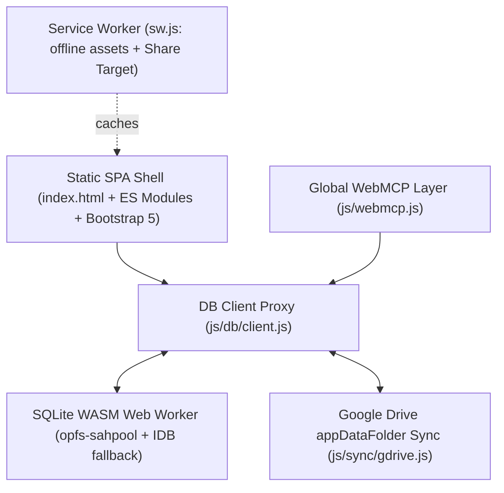

# UangKu v2 — Local-First PWA Plan (Branch: `v2`)

> **Execution Branch:** `v2` (already checked out — all atomic commits land directly on `v2`).  
> **Stack:** No-build static HTML + ES Modules + Bootstrap 5 + SQLite WASM (`@sqlite.org/sqlite-wasm` with `opfs-sahpool` + IndexedDB fallback) + Google Drive `appDataFolder` + Global WebMCP.

---

## 1. Goal & Architecture Overview

Move UangKu from a PHP/server-rendered app to a **zero-server, local-first PWA** that can be hosted for free on GitHub Pages / Cloudflare Pages while keeping **100% SQLite schema compatibility** with the existing PHP/Docker edition.



### Core Architectural Choices
- **Zero build step:** Pure ES Modules (`<script type="module">`), reusing UangKu's existing Bootstrap 5 UI, `html/public/assets/css/style.css`, icons, Highcharts, Flatpickr, and SweetAlert2.
- **100% SQLite file compatibility:** Uses the exact same `REKENING`, `TRANSAKSI`, `REKENING_SALDO`, `WISHLIST`, and `DB_INFO` schema as `.databases/default.sqlite`, so existing `.sqlite` backups can be imported/exported directly.
- **No `COOP`/`COEP` server headers required:** Uses `@sqlite.org/sqlite-wasm` with the **`opfs-sahpool` VFS** inside a Web Worker (works on GitHub Pages), with an automatic IndexedDB fallback for older browsers.
- **Offline attachments + Drive-as-SSOT:**
  - **Google Sign-In + Drive `appDataFolder` as Single Source of Truth (SSOT):** No Passkey/server auth is needed. Users can use the app locally right away, or click **Sign in with Google** (GIS OAuth2, `drive.appdata` non-sensitive scope only).
  - **On open:** Check `uangku.sqlite` `md5Checksum`/`modifiedTime` in `appDataFolder`; download into the local OPFS SQLite WASM cache if Drive is newer (or initialize a fresh DB and upload it if none exists).
  - **On every write:** Execute locally in SQLite WASM for instant UI, then debounced auto-save (~1.5s) back to Drive with an optimistic `modifiedTime` check (warns if another device modified Drive concurrently).
  - **Attachments (`uploads/`):** Stored as individual files in `appDataFolder` (uploaded once when attached, fetched on demand, cached locally in OPFS).
  - **Offline mode:** Local OPFS cache stays usable; edits set a `dirty` flag and auto-save when back online (with a conflict prompt if Drive moved ahead).
  - **Status pill:** Header displays a subtle `"Saved to Drive ✓" / "Syncing..." / "Offline"` status indicator.
- **Global WebMCP:** Because data lives in local SQLite WASM, WebMCP tools (`catat_transaksi`, `get_transaksi`, `update_transaksi`, `get_rekening`, `get_kelompok`, `get_harta`, and all Wishlist tools) work on **every route** without scraping page DOM.

---

## 2. Target Folder Layout (`pwa/` on branch `v2`)

```text
pwa/
├── index.html                  # SPA shell + bottom navbar + alert/modal containers
├── manifest.json               # PWA manifest (icons, shortcuts, share_target)
├── sw.js                       # Offline cache + Share Target handler
├── assets/                     # Reused CSS, fonts, icons, images from html/public/assets/
├── js/
│   ├── app.js                  # Hash router (#/record, #/transactions, #/rekening, #/wishlist, #/analisis, #/databases)
│   ├── config.js               # App constants (JENIS_TRANSAKSI, JENIS_UANG, Google Client ID slot)
│   ├── utils.js                # IDR formatting, date helpers, toast/Swal wrappers, CSV parser
│   ├── db/
│   │   ├── schema.js           # Exact SQLite DDL (REKENING, TRANSAKSI, WISHLIST, DB_INFO, REKENING_SALDO)
│   │   ├── worker.js           # SQLite WASM Web Worker (opfs-sahpool + IDB fallback + import/export Uint8Array)
│   │   └── client.js           # Promise RPC bridge to worker + local OPFS attachment storage
│   ├── models/
│   │   ├── transaksi.js        # Port of Transaksi.model.php (filter, getRelatedFamily, cashFlowGraph, compsGraph, CRUD)
│   │   ├── rekening.js         # Port of Rekening.model.php (getAll, getSaldoSummary, CashFlowGraph, CRUD)
│   │   └── wishlist.js         # Port of Wishlist.model.php (CRUD)
│   ├── sync/
│   │   └── gdrive.js           # GIS OAuth2 (drive.appdata) + push/pull uangku.sqlite & uploads + conflict check
│   ├── webmcp.js               # Global WebMCP tools + uangku://system_prompt (mirrors html/libs/mcp/*)
│   └── views/
│       ├── record.js           # Create/edit transaction + voice input + attachment upload + share target
│       ├── transactions.js     # Dashboard + table + detail modal (related family net total + attachment viewer)
│       ├── rekening.js         # Net Worth / Liquid Cash / Hutang / Harta summary + account CRUD + chart
│       ├── wishlist.js         # Wishlist CRUD + share-target text/URL intake
│       ├── analisis.js         # Analysis charts
│       └── databases.js        # CSV export/import, .sqlite download/upload, Reinitialize SQL, Google Drive Sync UI
└── README.md                   # Google Cloud OAuth Client ID setup + GitHub Pages / Cloudflare Pages deploy guide
```

---

## 3. Atomic Subagent + Independent Verifier Workflow

Every wave follows a strict **Builder → Independent Verifier → Atomic Commit** gate on branch `v2`:

1. **Builder Subagent** (write-enabled subagent, scoped strictly to that wave's files) implements only that wave's atomic unit.
2. **Independent Verifier Subagent** (separate read-only `research` subagent that did *not* write the code) audits the diff against the wave's checklist (SQL/schema parity, null safety, XSS escaping, ES module imports, edge cases) and returns `PASS` or a concrete defect list.
3. If any defect is found, the Builder fixes it and the Verifier re-checks.
4. Only after `PASS` do we create **1 atomic Conventional Commit** for that wave on `v2`.

---

## 4. Wave-by-Wave Breakdown (Wave 0 → Wave 7)

| Wave | Atomic Scope | Files Touched | Independent Verifier Checklist | Commit Message |
|---|---|---|---|---|
| **Wave 0** | Static PWA Shell & Assets | Copy reused assets from `html/public/assets/`, create `pwa/index.html`, `pwa/manifest.json`, `pwa/sw.js`, `pwa/js/config.js`, `pwa/js/utils.js`, `pwa/js/app.js` | Valid HTML/ES module paths, all asset links resolve, SW caches shell + handles Share Target without PHP routes | `feat(pwa): Add static PWA shell, router, manifest, and service worker` |
| **Wave 1** | SQLite WASM Engine & Schema | `pwa/js/db/schema.js`, `pwa/js/db/worker.js`, `pwa/js/db/client.js` | Exact DDL parity with `.databases/default.sqlite` (`REKENING`, `TRANSAKSI`, `WISHLIST`, `DB_INFO`, `REKENING_SALDO`), safe `opfs-sahpool` + IDB fallback, clean binary export/import, parameterized queries only | `feat(pwa): Add SQLite WASM worker and OPFS storage client` |
| **Wave 2** | Client Models *(parallelizable with Wave 3)* | `pwa/js/models/transaksi.js`, `pwa/js/models/rekening.js`, `pwa/js/models/wishlist.js` | 1:1 query parity with PHP models (`getSaldoSummary`, `getRelatedFamily` with `net`, `filter()`, `reinitialize()` negative-balance handling, `cashFlowGraph`, `compsGraph`) | `feat(pwa): Port Transaksi, Rekening, and Wishlist models to client SQLite` |
| **Wave 3** | Google Drive `appDataFolder` Sync *(parallelizable with Wave 2)* | `pwa/js/sync/gdrive.js` | GIS OAuth2 token flow (`drive.appdata` only), no hardcoded secrets, `modifiedTime`/`md5Checksum` conflict detection before overwrite, attachment blob sync | `feat(pwa): Add Google Drive appDataFolder sync module` |
| **Wave 4A** | Core Views: Record & Transactions | `pwa/js/views/record.js`, `pwa/js/views/transactions.js` | All transaction types (`Pengeluaran`/`Pemasukan`/`Pindah Buku`), `harta`, `rutin`, `kelompok`, `relasi_transaksi`, net total in related modal, XSS-safe rendering, OPFS attachment preview | `feat(pwa): Add Record and Transactions PWA views` |
| **Wave 4B** | Core Views: Rekening, Wishlist, Analisis | `pwa/js/views/rekening.js`, `pwa/js/views/wishlist.js`, `pwa/js/views/analisis.js` | Schema-free Net Worth / Liquid Cash / Hutang / Harta cards, account CRUD, wishlist CRUD + share-target intake, Highcharts cleanup on `unmount()` | `feat(pwa): Add Rekening, Wishlist, and Analisis PWA views` |
| **Wave 5** | Databases & Google Drive Sync View | `pwa/js/views/databases.js` | CSV export/import (BOM + flexible delimiter/date parsing), `.sqlite` local backup/restore, `reinitialize()` with confirmation, Google Drive sign-in / Pull / Push / conflict resolution UI | `feat(pwa): Add Databases backup and Google Drive sync view` |
| **Wave 6** | Global WebMCP Layer | `pwa/js/webmcp.js` | Full parity with `html/libs/mcp/transaksi.lib.php`, `rekening.lib.php`, `resources.lib.php` (including partial `update_transaksi`, unified `get_transaksi`, CC/Loan rules, and Wishlist tools) | `feat(pwa): Add global WebMCP tools and system prompt` |
| **Wave 7** | End-to-End Integration Audit & Deploy Docs | `pwa/README.md` | Full cross-file ES module import check, zero leftover PHP endpoints (`/Transaction/...`, `/Record/...`), offline-first readiness verification | `docs(pwa): Add deployment and Google OAuth setup guide` |

---

## 5. Key Pitfalls & Guardrails

- **No `COOP`/`COEP` needed:** Using `opfs-sahpool` avoids `SharedArrayBuffer` header requirements on GitHub Pages / Cloudflare Pages.
- **No secrets committed:** Google OAuth Client ID is configurable in `pwa/js/config.js` and overridable in the Sync settings UI via `localStorage` so anyone can self-host on their own fork.
- **Conflict safety on Drive sync:** Always compare remote `modifiedTime` / `md5Checksum` against the last synced metadata before pushing or pulling, prompting the user on divergence rather than silently overwriting.
- **No cross-route memory leaks:** Every view exports `mount(container, params)` and `unmount()` so Highcharts, Flatpickr, and DataTables instances are destroyed cleanly on hash navigation.
