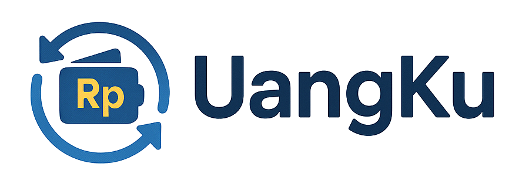
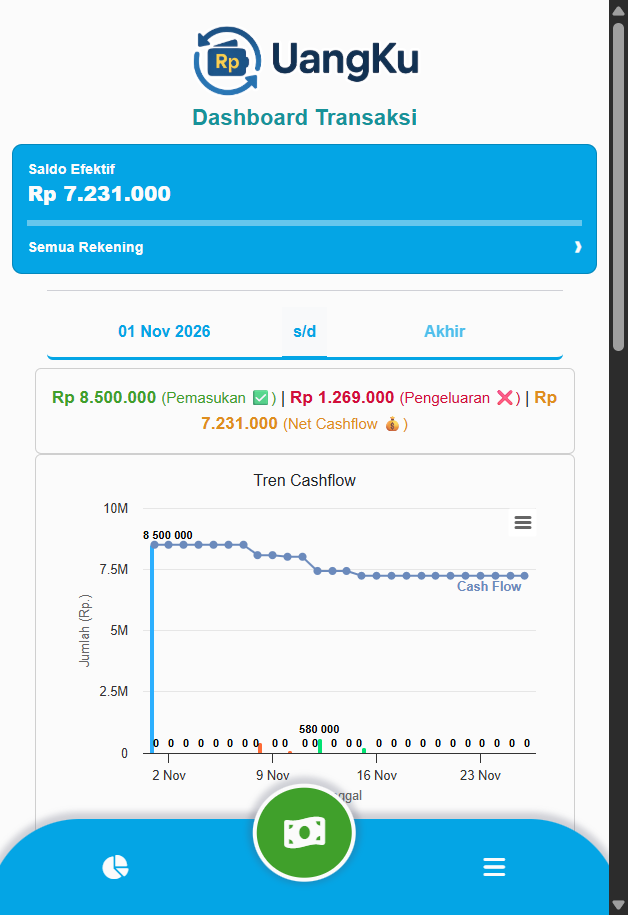
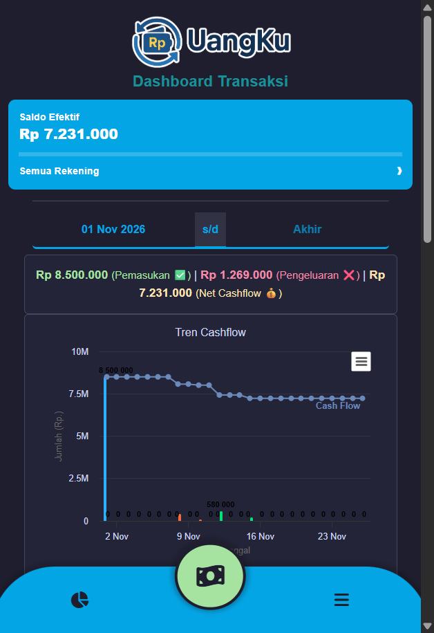
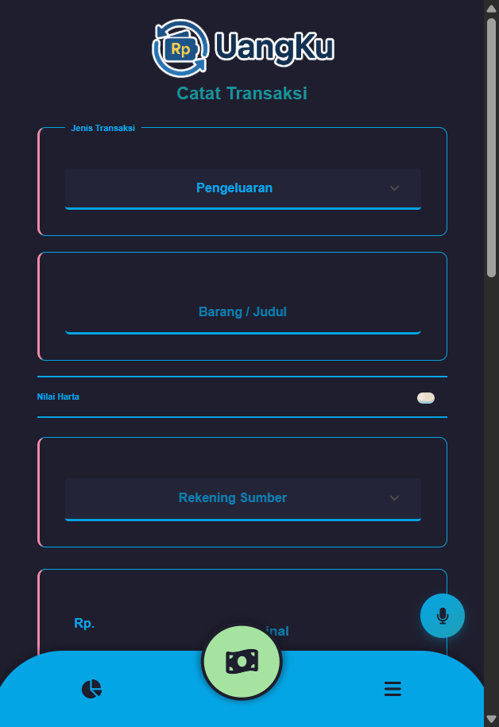
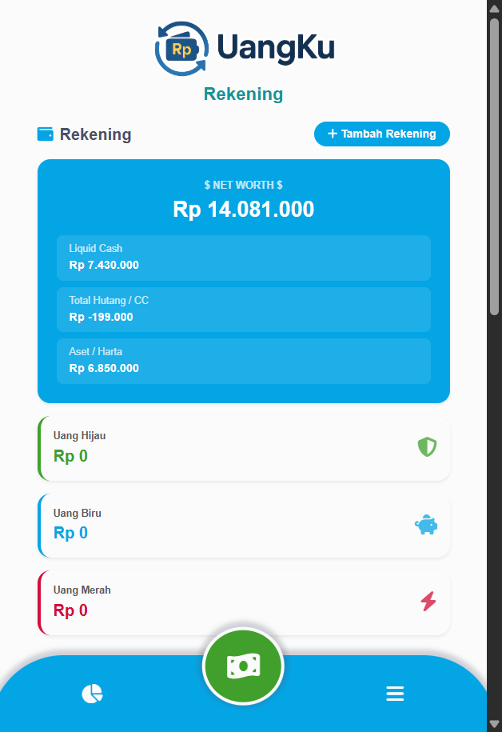

# KasIn

<div align="center">
  

Personal cashflow, multi-account, asset depreciation, and wishlist tracker that runs in your browser with optional Google Drive sync and an MCP server.

[Web App Guide](web/README.md) | [MCP Server Guide](mcp-server/README.md)

</div>

## Features

- **Offline SQLite in the browser:** Data stays in browser storage and works offline, with multi-tab support.
- **Direct `.sqlite` file sync:** Link or create a `.sqlite` file on your device and save changes automatically (Chromium browsers).
- **Optional Google Drive backup:** Sync your database to your own Google Drive app folder.
- **Accounts, assets, cards & loans:** Track cash, bank accounts, foreign currencies, depreciating assets (`Harta`), credit cards, loans, and a wishlist.
- **Voice input & charts:** Record entries by voice, run spending charts, and connect AI tools via WebMCP.
- **Remote MCP server:** Let Claude Web or Gemini Web read and record transactions in your Google Drive database.

## Screenshots

<div align="center">

|                                   Dashboard (Light)                                    |                                   Dashboard (Dark)                                   |                                 Record (Dark)                                  |                                   Rekening (Light)                                   |
| :------------------------------------------------------------------------------------: | :----------------------------------------------------------------------------------: | :----------------------------------------------------------------------------: | :----------------------------------------------------------------------------------: |
|  |  |  |  |

</div>

## Quick Start

### Web App (`web/`)

Open **[https://kha-dr.github.io/Uangku/](https://kha-dr.github.io/Uangku/)**.

To host it yourself or set up your own Google Client ID, see [web/README.md](web/README.md).

### Remote MCP Server (`mcp-server/`)

Run with Docker using [`khad1r/kasin-mcp:latest`](https://hub.docker.com/r/khad1r/kasin-mcp):

```bash
docker run -d \
  --name kasin-mcp \
  -p 8787:8787 \
  -e GOOGLE_CLIENT_ID=your-client-id.apps.googleusercontent.com \
  -e GOOGLE_CLIENT_SECRET=your-client-secret \
  khad1r/kasin-mcp:latest
```

Or with Docker Compose:

```yaml
services:
  kasin-mcp:
    image: khad1r/kasin-mcp:latest
    ports:
      - "8787:8787"
    environment:
      - GOOGLE_CLIENT_ID=your-client-id.apps.googleusercontent.com
      - GOOGLE_CLIENT_SECRET=your-client-secret
    restart: unless-stopped
```

See [mcp-server/README.md](mcp-server/README.md) for Cloudflare Workers, Google OAuth setup, Cloudflare MCP Portal, and connecting Claude or Gemini.

## Google Drive Sync & Token Refresh

- **Web App (`web/`):** Browser login uses Google Identity Services without a backend secret, so Google gives a 1-hour access token and no refresh token. Reloading within that hour keeps you signed in. Once it expires (or after closing the installed PWA), edits still save locally and queue up, and a small **Sync Drive** button appears in the header so you can reconnect and upload in one tap.
- **MCP Server (`mcp-server/`):** Uses server-side OAuth (`access_type=offline`), so your MCP client or Cloudflare MCP Portal refreshes expired tokens automatically. Set your Google Cloud OAuth consent screen to **In production** so refresh tokens don't expire after 7 days.

## Planned

- **Multi-item receipt entry (`web/`):** Enter multiple receipt items at once with automatic discount splitting.
- **Offline receipt scan (`web/`):** Optional on-device receipt reading (watching [Cactus Compute Mirage](https://huggingface.co/Cactus-Compute/mirage) once an official browser SDK ships, or a small OCR fallback).

## License

Copyright (c) 2025-2026 khadr.dev.

Licensed under the **GNU Affero General Public License v3.0** ([LICENSE](LICENSE)).

- **Third-Party Libraries:** External CDN libraries (including Highcharts, which is free for personal/non-commercial use) follow their own licenses.
- **Commercial Licensing:** Commercial licenses are available from `khadr.dev`.
